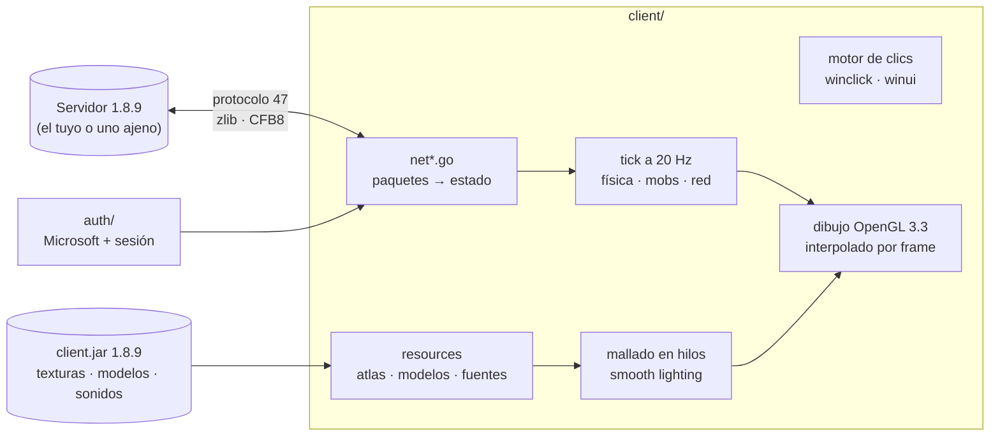

<div align="center">

# ⛏️ gocraft

**Minecraft 1.8.9 reescrito desde cero en Go.**
Un cliente con OpenGL, un servidor, y un montón de ganas de que se sienta como el original.


-62B47A)


</div>

---

## ¿Qué es esto?

gocraft es una reimplementación **completa** del cliente de Minecraft Java **1.8.9** (protocolo 47) en Go, más un
servidor compatible. No es un *wrapper* ni un mod: el renderizado, la física, los mobs, la red, el inventario, el
sonido y la interfaz están escritos aquí, y lo que no se puede escribir (texturas, modelos, sonidos) se lee del
`client.jar` de 1.8.9 **que ya tienes**.

La meta fue siempre la misma: **que se juegue como vanilla**. Cada regla de física, cada fórmula de luz y cada
detalle del protocolo se copia del comportamiento original y se comprueba con una prueba que lo fija. Cuando algo se
siente raro en un servidor real, hay herramientas para grabar la sesión y ver qué paquetes lo causan.

- 🎮 **Juega en un mundo propio** (formato Anvil de 1.8.9) o **se conecta a servidores de terceros**.
- 🌐 Probado contra una red grande de 1.8 (`mc.universocraft.com`): entra, aguanta el anti-bot, ve el lobby, usa los menús.
- 🧪 **413 pruebas** que reproducen paquetes contra el cliente, sin tocar ningún servidor real.
- 🔬 Herramientas de diagnóstico de red (`-netlog` y `tools/pvpreport.py`) pensadas para cazar el "esto no se siente igual".

---

## Capturas

Todas salen de las escenas de demo del propio cliente (`-demo -screen ...`), así que se pueden regenerar. Los
textos y los nombres son de ejemplo.

| | |
|---|---|
| <br>**Iluminación suave** (*smooth lighting*) con oclusión ambiental | <br>**Mobs** que un servidor puede mostrar, con sus modelos |
| <br>**Jugadores** con armadura, objetos en mano y la caña con su línea | <br>**Partículas** y efectos que manda el servidor |
| <br>**Items** en el suelo, animación de recogida y **orbes de experiencia** | <br>**Carteles** con su texto y colores |
| <br>**Grietas** de los diez estados de picado | <br>**Barra de jefe** y panel lateral del *scoreboard* |
| <br>**Lista de jugadores** con cabecera y pie | |

---

## Empezar en 2 minutos

**Necesitas:** Go 1.26+, OpenGL 3.3 con GLFW (en Linux, los paquetes de desarrollo de X11/Wayland y GL), y el
`client.jar` de Minecraft 1.8.9 (por defecto en `~/mc-1.8.9-run/client.jar`, o con `-jar`).

```sh
git clone <este repo> && cd gocraft
go build -o gocraft ./cmd/gocraft

./gocraft                                                    # menú: un jugador, multijugador, opciones
./gocraft -connect mc.universocraft.com:25565 -name TuNombre # directo a un servidor
./gocraft -world ~/.minecraft/saves/MiMundo                  # abre un mundo 1.8.9
```

Para servidores *online mode* hace falta **tu propia** cuenta de Microsoft con Minecraft Java: mira
[ACCOUNT.md](ACCOUNT.md). gocraft no trae ninguna aplicación de Azure ni credenciales de nadie.

---

## Qué trae

<details open>
<summary><b>🧱 Mundo y mallado</b></summary>

- Mundos Anvil de 1.8.9 (lectura y escritura), generación de terreno, **Overworld, Nether y End**, portales.
- **Smooth lighting** como el del juego (`BlockModelRenderer.renderModelAmbientOcclusionQuad`): cada esquina promedia la luz
  de las celdas vecinas y se oscurece por oclusión ambiental. `ao:0` en `options.txt` lo apaga.
- Lightmap con la fórmula exacta de vanilla (sol, antorcha parpadeante, *gamma*), ciclo día/noche, niebla por dimensión.
- Mallado en hilos de trabajo con presupuesto por frame, para que cargar chunks no cause tirones.
- Animaciones de texturas (agua, lava, fuego), hojas rápidas/elegantes, resource packs.
</details>

<details>
<summary><b>🏃 Movimiento y física</b></summary>

- Física del jugador copiada del bytecode de 1.8.9: velocidades de caminar y correr con los modificadores en su orden
  (`0.2158` y `0.2806` bloques/tick), salto, agua, lava, escaleras, hielo, slime, caída, vuelo.
- **Sprint como el original**: duración de 600 ticks, doble toque, hambre, y el **FOV que se ensancha** al correr
  (×1.15) suavizado cada tick.
- Interpolación entre ticks a 20 Hz: lo que ves nunca se mueve a saltos aunque el juego corra a otra tasa.
- Colisiones desde los modelos de bloque, escalones, losas, vallas, nieve por capas.
</details>

<details>
<summary><b>🌐 Multijugador (protocolo 47)</b></summary>

- Login offline y online (cifrado AES/CFB8 + servidor de sesión de Mojang con tu cuenta de Microsoft).
- **Chat** con colores y JSON, **autocompletado con Tab**, títulos, *action bar*, cabecera y pie de la lista.
- **Jugadores** con skin real, armadura (incluida la teñida), objetos en mano, poses, interpolación de vanilla.
- **Mobs** con modelo propio (creeper, esqueleto, araña, zombi, slime, pigman, bruja, cerdo, oveja, vaca, gallina,
  calamar, conejo, aldeano, murciélago, enderman, blaze, golem de hierro, lobo…) con su metadata: bebés, colores de
  oveja, tamaño de slime, wolf amansado o furioso.
- **Items** en el suelo con su animación de recogida, **orbes de experiencia**, proyectiles, anzuelos con su línea.
- **Partículas** (unas 30), efectos de mundo, explosiones, grietas al picar, tapas de cofre, notas, carteles.
- **Scoreboard** (lateral, en la lista y bajo el nombre; números o corazones), **barra de jefe** (Wither/Dragón falsos),
  **borde del mundo**, equipos con prefijo y color.
- Ventanas del servidor con nombres y *lore*, y clics que envía **tal como los envía el juego**.
</details>

<details>
<summary><b>🗂️ Inventario y ventanas</b></summary>

Un solo **motor de clics** (copia de `Container.slotClick`) sirve al inventario, la mesa de crafteo, cofres, hornos y
las ventanas que abre un servidor:

- Clic izquierdo y derecho, **shift-clic** con la ruta de cada ventana, **teclas 1-9**, clic central, **Q / Ctrl+Q**,
  soltar fuera, **arrastrar para repartir** (con vista previa) y **doble clic** para juntar.
- El NBT de cada item viaja con él, y el cliente predice el resultado como el juego; si el servidor rechaza un clic,
  se repone con lo que el servidor manda.
</details>

<details>
<summary><b>⚔️ PvP y combate</b></summary>

- Golpes con el alcance, la caja y el orden de paquetes de vanilla; el frenazo del atacante al pegar, el *knockback*
  recibido, la sacudida de cámara y el destello rojo.
- Caña de pescar (se lanza al aire, al suelo **o a un rival**), bloqueo con espada, arco, comida.
- Si algo no cuadra con un servidor, `tools/pvpreport.py` lo explica a partir de un log (ver más abajo).
</details>

<details>
<summary><b>🔊 Audio e interfaz</b></summary>

- Sonido posicional con los OGG del jar, decodificados en segundo plano, con pasos, bloques, mobs y eventos del servidor.
- Interfaz completa: título, mundos, opciones, controles, packs, multijugador, cuenta, pausa, muerte, creativo, ventanas.
- Texto con la fuente del juego, **colores, negrita, subrayado, tachado** y las páginas unicode (▬ ✔ ❤).
</details>

<details>
<summary><b>🖥️ Servidor propio</b></summary>

Un servidor mínimo de 1.8.9 (mundo, jugadores, combate básico con invulnerabilidad, *knockback*, armadura y sprint)
que sirve para probar el cliente de punta a punta sin depender de nadie.
</details>

---

## Cómo está hecho (por dentro)



**El bucle.** La lógica corre a **20 ticks por segundo** y el dibujo a la tasa que dé la pantalla. Entre ticks, la
posición se interpola, de modo que el movimiento es suave a cualquier FPS. Los paquetes del servidor se aplican al
empezar cada frame, y lo que un clic cuesta (por ejemplo, el frenazo al golpear) se paga al empezar el siguiente
tick, que es donde el juego original procesa los clics.

**Fiel a vanilla, con pruebas.** Cada comportamiento que importa tiene una prueba que lo fija, y varias comprueban
que *detectan* el fallo: se rompe a propósito el comportamiento y se comprueba que la prueba falla. Ejemplos:
velocidades de sprint al décimo de milésima, `slotClick` modo por modo, el orden de eventos de un golpe tras un
*knockback*.

**Las pruebas no necesitan un servidor.** Los paquetes se reproducen contra el cliente (`decodeFrame`), de modo que la
suite corre sin red y tarda unos 30-40 segundos.

---

## Herramientas para cuando "algo no se siente igual"

Un cliente reimplementado se parece a vanilla hasta que un servidor con anticheat nota la diferencia. Para eso:

```sh
./gocraft -connect mi.servidor:25565 -netlog /tmp/sesion.net     # graba la partida
python3 tools/pvpreport.py /tmp/sesion.net                       # y la analiza
```

`-netlog` apunta cada paquete con su dirección, id y tamaño, **decodifica los que importan** (posiciones, teleports,
knockback, golpes, sprint, movimientos de entidades) y añade notas del propio cliente: la distancia al rival en cada
golpe, cada corrección del servidor con el estado del jugador, y los frames lentos.

`tools/pvpreport.py` resume: cuántas veces te recolocó el servidor y qué pasó justo antes, qué ataques aceptó y por qué
rechazó los demás (inmunidad del rival o alcance), si algún golpe que debió salir no salió, y cuánto va dibujado cada
rival respecto a su posición real.

---

## Flags útiles

| Flag | Para qué |
|---|---|
| `-connect host:port` | entrar directo a un servidor |
| `-name` | nombre en modo offline |
| `-world carpeta` | abrir un mundo 1.8.9 |
| `-jar`, `-options`, `-packs`, `-saves` | dónde están tu jar, `options.txt`, resource packs y mundos |
| `-netlog fichero` | grabar y decodificar los paquetes (ver arriba) |
| `-bench N`, `-cpuprofile f` | vuelo fijo de N segundos con estadísticas / perfil de CPU |
| `-nosound` | sin sonido |

`./gocraft -h` los lista todos. Variables de entorno: `GOCRAFT_BRAND` (el *brand* que se anuncia; por defecto
`gocraft`, y **no** se disfraza de vanilla), `GOCRAFT_MSA_CLIENT_ID` (ver `ACCOUNT.md`), `GOCRAFT_NO_AUDIO`,
`GOCRAFT_PREVIEW`.

### Regenerar las capturas

```sh
xvfb-run -a ./gocraft -demo -screen netmobs -look 0,18 -screenshot /tmp/mobs.png
```

Escenas: `netmobs`, `netfish`, `netparticles`, `netitems`, `netboss`, `netborder`, `netlist`, `netchat`, `signs`,
`cracks`, `drag`, `survival`, `inventory`, `title`… (las `net*` necesitan `-demo`).

---

## Pruebas

```sh
go vet ./... && go test ./...
```

413 pruebas. Las del cliente necesitan el `client.jar` (si no está, se saltan). Una de red
(`TestGeneratedWorldOverTheNetwork`) es sensible al tiempo y puede fallar de vez en cuando bajo carga.

---

## Mapa del código

| Carpeta | Contenido |
|---|---|
| `cmd/gocraft` | el ejecutable y el decodificador del `-netlog` |
| `client/` | el juego: render, física, mobs, interfaz y `net*.go` (multijugador) |
| `server/` | el servidor propio |
| `proto/` | tramas del protocolo: VarInt/VarLong, compresión, cifrado CFB8 |
| `auth/` | inicio de sesión con Microsoft y servidor de sesión |
| `anvil/`, `world/`, `worldgen/` | formato Anvil, el mundo en memoria y la generación |
| `tools/` | herramientas de análisis (`pvpreport.py`) |

Piezas del cliente que conviene conocer:

- `winclick.go` · `winmap.go` · `winui.go`: el motor de clics, su unión con el almacenamiento y el ratón/teclado.
- `smooth.go` · `mesh.go` · `lighting.go`: iluminación suave, mallado y lightmap.
- `net.go` (lectura de paquetes y estado), `netmob.go`, `netitem.go`, `netparticles.go`, `xporbs.go`, `signs.go`,
  `cracks.go`, `bossbar.go`, `worldborder.go`: lo que un servidor muestra.
- `movement.go` · `fov.go` · `pvp.go`: física del jugador, campo de visión y combate.

---

## Estado

**Funciona:** entrar y jugar en un servidor grande de 1.8, el lobby, los menús, el chat, el scoreboard, la lista, los
mobs, los items, el inventario completo, la caña, el bloqueo, y un mundo propio con supervivencia.

**En afinación:** el PvP competitivo contra servidores con anticheat estricto. Se trabaja con datos reales de partidas
(ver `tools/pvpreport.py`). Las ventanas de encantamiento, yunque y alquimia aún se dibujan como filas de cofre.

El detalle de lo hecho y lo pendiente está en [ROADMAP.md](ROADMAP.md).

---

## Aviso legal y buen uso

gocraft es un proyecto independiente. **No está afiliado ni respaldado por Mojang ni por Microsoft.** «Minecraft» es
marca de Mojang Synergies AB.

- **No incluye ningún recurso de Mojang.** Las texturas, modelos y sonidos se leen del `client.jar` que tú ya tienes.
- Para servidores *online mode* se usa **tu propia cuenta**, con tu propia aplicación de Azure. Nunca el identificador
  de otro launcher.
- Respeta las normas de cada servidor. gocraft anuncia su propio *brand* y no se hace pasar por el cliente original ni
  busca esquivar la verificación de ningún servidor.

---

<div align="center">

Hecho con paciencia, un `client.jar` y mucho `go test`. ⛏️

</div>
