# gocraft

Reimplementación del cliente de Minecraft Java 1.8.9 (protocolo 47) en Go, con un servidor compatible.
El cliente renderiza con OpenGL 3.3 y puede jugar en mundos locales (formato Anvil de 1.8.9) o conectarse a
servidores de terceros. No contiene recursos de Mojang: las texturas, los modelos y los sonidos se leen del
`client.jar` de 1.8.9 que el usuario ya posee.

El objetivo de diseño es la fidelidad con el comportamiento de vanilla. Cada subsistema se implementa a partir de la
lógica original (física, fórmulas de iluminación, lógica de clics de ventanas, orden de paquetes) y se fija con
pruebas automatizadas que reproducen paquetes contra el cliente, sin servidor real.

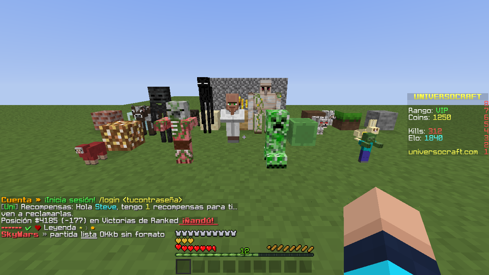

## Contenido

1. [Requisitos y uso](#requisitos-y-uso)
2. [Capturas](#capturas)
3. [Progreso de la reimplementación](#progreso-de-la-reimplementación)
4. [Arquitectura](#arquitectura)
5. [Cobertura del protocolo](#cobertura-del-protocolo)
6. [Fidelidad con vanilla](#fidelidad-con-vanilla)
7. [Diagnóstico de sesiones de red](#diagnóstico-de-sesiones-de-red)
8. [Pruebas](#pruebas)
9. [Opciones y flags](#opciones-y-flags)
10. [Limitaciones conocidas](#limitaciones-conocidas)
11. [Aviso legal](#aviso-legal)

## Requisitos y uso

- Go 1.26 o superior.
- OpenGL 3.3 y GLFW (en Linux, los paquetes de desarrollo de X11 o Wayland y de GL).
- El `client.jar` de Minecraft 1.8.9 (por defecto `~/mc-1.8.9-run/client.jar`; se cambia con `-jar`).

```sh
make                       # gocraft (el juego) y gocraft-server (el servidor)
make check                 # go vet y las pruebas
make release               # dist/gocraft-<versión>-<so>-<arq>.tar.gz con su sha256

./gocraft                                    # menú: un jugador, multijugador, opciones
./gocraft -connect host:25565 -name Jugador  # conexión directa (modo offline)
./gocraft -world /ruta/al/mundo              # abrir un mundo 1.8.9
./gocraft -version                           # la versión del paquete (igual en gocraft-server)
```

Los servidores en modo online exigen una cuenta de Microsoft con Minecraft Java y una aplicación de Azure propia;
el procedimiento está en [ACCOUNT.md](ACCOUNT.md). El proyecto no incluye ninguna aplicación ni credencial.

## Capturas

Generadas con las escenas de demostración del cliente (véase [Escenas de demostración](#escenas-de-demostración)).
Los textos y los nombres son de ejemplo.

Sin ningún paquete de recursos activo, el cliente carga las texturas originales de 1.8.9 desde el `client.jar`.
Estas capturas se tomaron con un paquete de recursos de terceros activado (de 8x), así que las texturas no son
las originales. Los paquetes se leen de la carpeta indicada con `-packs` y se activan en `options.txt`
(`resourcePacks`) o en la pantalla de paquetes de recursos del cliente.

| | |
|---|---|
| 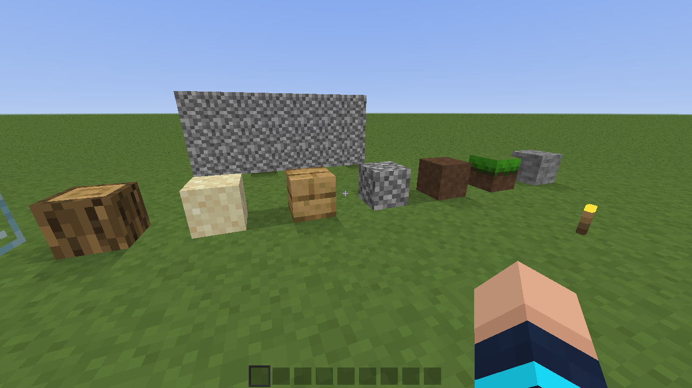<br>Iluminación suave con oclusión ambiental | <br>Modelos de mobs de servidor |
| 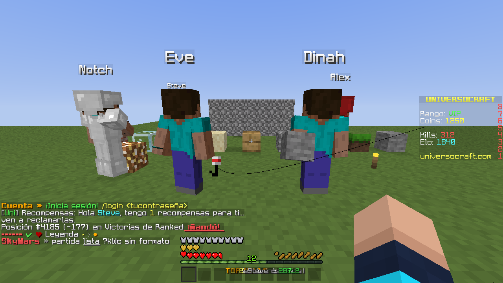<br>Jugadores con armadura, objetos en mano y caña | 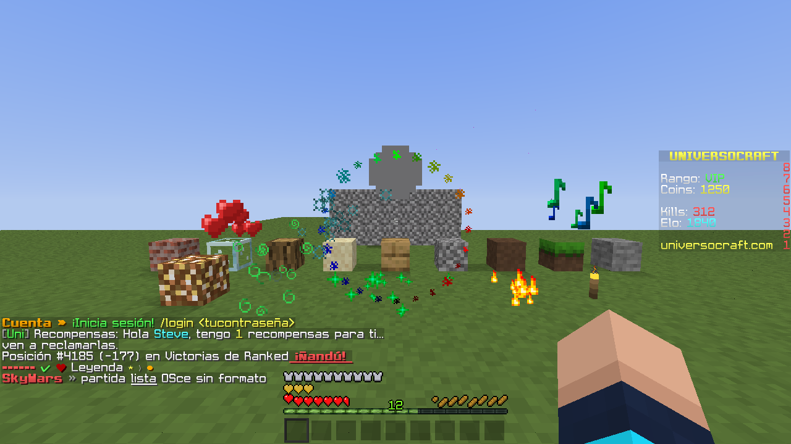<br>Partículas y efectos de servidor |
| 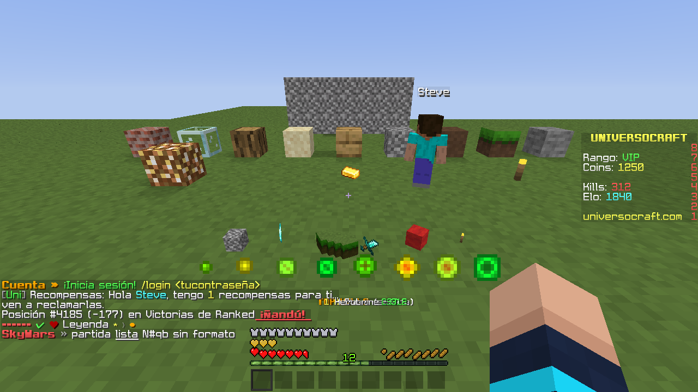<br>Items en el suelo y orbes de experiencia | 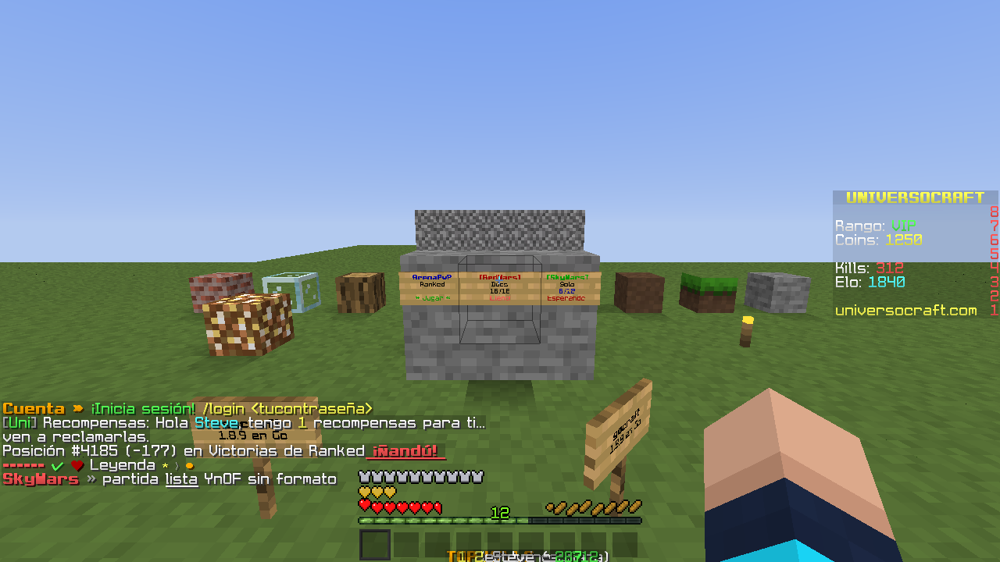<br>Carteles con texto y color |
| 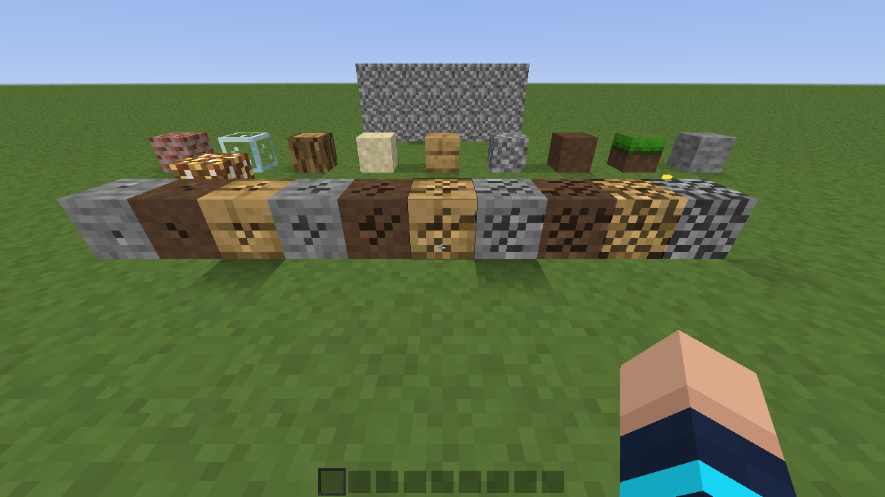<br>Diez estados de picado | 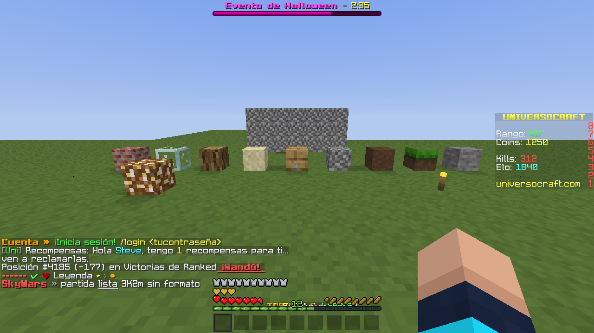<br>Barra de jefe y *scoreboard* lateral |
| 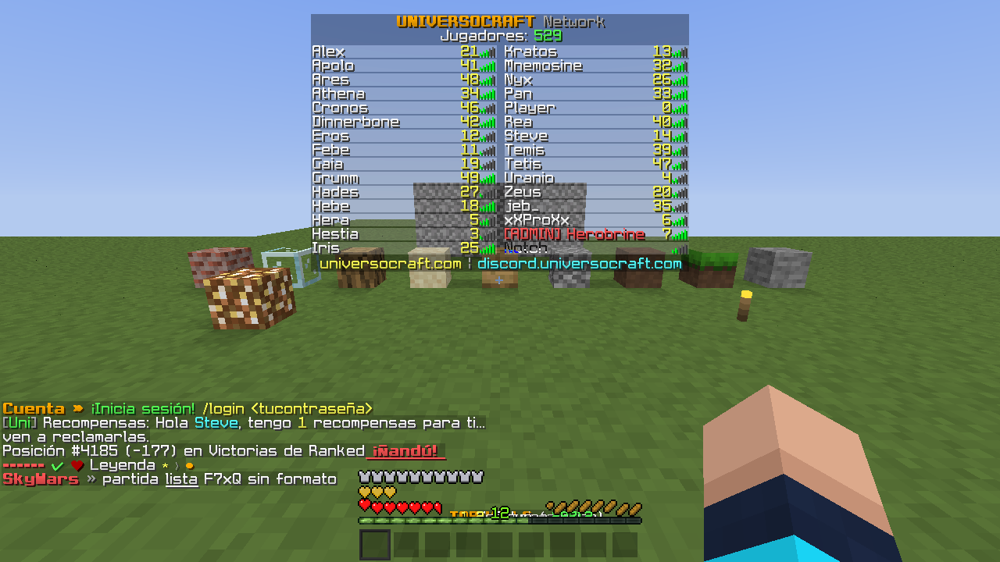<br>Lista de jugadores con cabecera y pie | 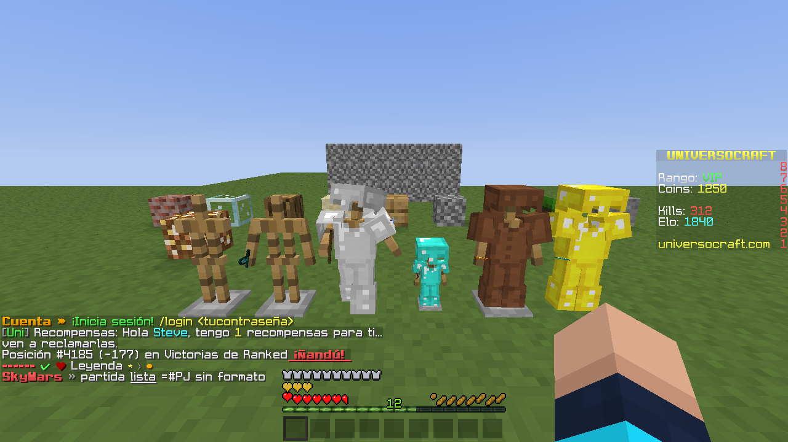<br>Armor stands con pose, armadura y objetos |
| 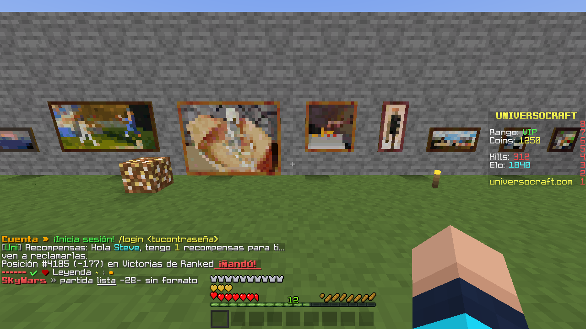<br>Cuadros de todos los tamaños | 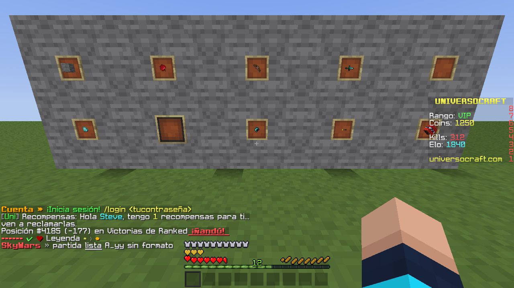<br>Item frames con objetos y bloques |
| 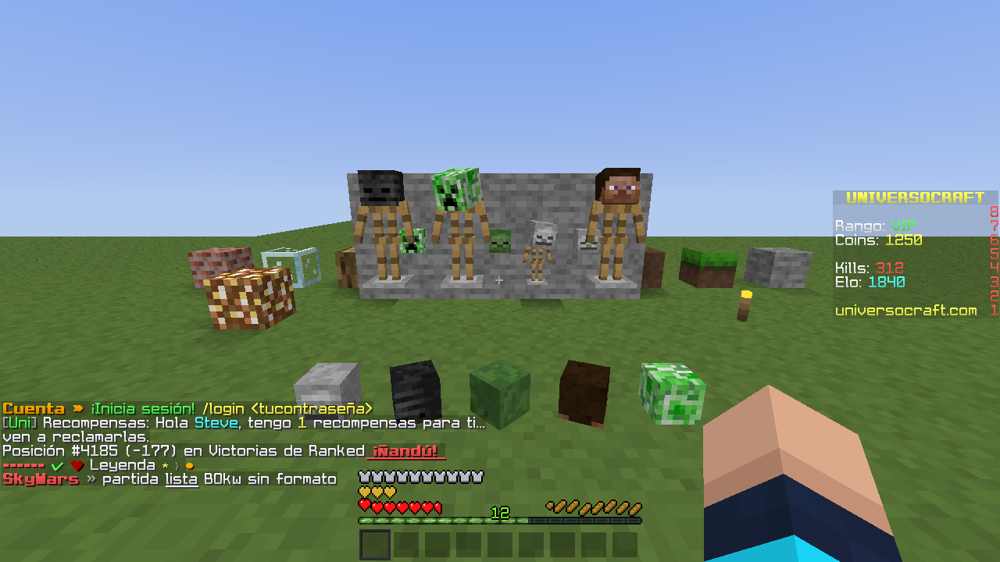<br>Cabezas en bloques y en armor stands | |

## Progreso de la reimplementación

<!-- progress:start -->

**Avance global: 48 %** `██████████████░░░░░░░░░░░░░░░░`

| Área | Peso | Avance | | Hecho | Pendiente |
|---|--:|--:|---|---|---|
| Render | 18.3 % | 54 % | `█████░░░░░` | mallado por columnas, luz suave, modelos de bloque, 22 modelos de mobs, partículas, cielo, nombres y carteles, mapas en item frames | renderers de caballo, ocelote, guardián, snowman, wither y dragón; mapa en la mano |
| Entidades | 16.6 % | 40 % | `████░░░░░░` | física y movimiento del jugador, jugadores remotos, items, proyectiles, anzuelo, armor stands, cuadros, item frames, cabezas, 22 tipos de mob con IA básica | unos 38 tipos de entidad, la mayoría de las 80 metas de IA, minecarts, monturas |
| Cliente (interfaz, opciones, sonido) | 15.2 % | 53 % | `█████░░░░░` | HUD, chat con estilos, menús, inventario, opciones, sonido, paquetes de recursos, mundos guardados | inventario creativo, editor de carteles, libros, estadísticas |
| Generación de mundo | 13.6 % | 55 % | `██████░░░░` | biomas exactos, terreno al 99.9 %, cuevas, barrancos, nether, end, árboles, minerales, lagos | aldeas, fortalezas, minas, templos, monumentos, botín de mazmorras, mesas de arcilla y árboles gigantes |
| Bloques y entidades-bloque | 12.2 % | 27 % | `███░░░░░░░` | colisiones, dureza y herramientas, cofres, hornos, carteles, notas, apertura de tapas, cabezas y spawners | flujo de fluidos, cultivos, fuego, redstone, pistones, ticks aleatorios |
| Servidor integrado y comandos | 8.2 % | 18 % | `██░░░░░░░░` | streaming de chunks, jugadores, combate básico, aparición, guardado del mundo y de los jugadores, comandos básicos | los otros 50 comandos del juego, mobs del lado del servidor, ventanas e inventario del lado del servidor |
| Items, crafteo y contenedores | 7.3 % | 61 % | `██████░░░░` | motor de clics (modos 0-6), 111 recetas, ventanas de cofre, horno, mesa, encantamientos, yunque y alquimia | faro, aldeano, caballo, pociones, libros, fuegos artificiales |
| Protocolo de red | 5.5 % | 86 % | `█████████░` | 62 de 74 paquetes servidor→cliente y 23 de 24 cliente→servidor, compresión, login en línea y sin conexión | 12 paquetes servidor→cliente, 1 cliente→servidor |
| Núcleo del mundo | 3.1 % | 72 % | `███████░░░` | formato Anvil, iluminación, chunks | guardado completo de entidades y estadísticas |

El peso de cada área es su parte del bytecode del client.jar de 1.8.9 (2507 clases, 1.22 MB), agrupado por subsistema a partir de la herencia de las clases. El porcentaje de avance es una estimación del mantenedor, área por área; solo el protocolo se contó paquete a paquete. El total es el promedio ponderado.

| Fecha | Commit | Avance global |
|---|---|--:|
| 2026-11-01 | `97fe831` | 48.2 % |
| 2026-10-31 | `d772ecf` | 44.5 % |

<!-- progress:end -->

## Arquitectura

### Paquetes

| Directorio | Contenido |
|---|---|
| `cmd/gocraft` | Ejecutable y decodificador del registro de red (`-netlog`). |
| `client/` | Juego: renderizado, física, mobs, interfaz y la capa de red (`net*.go`). |
| `server/` | Servidor propio: mundo (con guardado), jugadores, comandos básicos y combate. |
| `proto/` | Tramas del protocolo: VarInt/VarLong, lectura y escritura de paquetes, compresión zlib, cifrado CFB8. |
| `auth/` | Inicio de sesión con Microsoft y servidor de sesión de Mojang. |
| `anvil/`, `world/`, `worldgen/` | Formato Anvil, mundo en memoria (columnas con luz y bioma) y generación de terreno. |
| `tools/` | Utilidades de análisis (`pvpreport.py`). |

### Hilos y flujo de datos

El estado del juego pertenece exclusivamente al hilo principal. Los demás hilos solo producen datos:

- **Lectura de red.** Una goroutine por conexión lee y descomprime paquetes y los convierte en cierres
  (`parsePacketIn` devuelve `func(*game)`). Los paquetes baratos (jugadores, chat, salud, entidades) van a una cola
  ordenada (`inbox`); los que modifican el mundo (columnas, bloques) van a otra (`heavy`) con un presupuesto de tiempo
  por frame. El hilo principal los aplica.
- **Mallado.** Un grupo de trabajadores genera la geometría de cada columna a partir de una copia con relleno
  (`world.Padded`, 18×18×256 con los bordes y las esquinas de los vecinos). Los resultados se suben a la GPU con un
  presupuesto de 3 ms por frame.
- **Audio.** Los OGG se decodifican en segundo plano; un mezclador independiente reproduce las voces. Un sonido aún no
  decodificado se omite en lugar de bloquear.
- **Skins.** Se descargan en goroutines propias y se suben a la GPU en el hilo principal.

### Bucle principal

La lógica corre a 20 ticks por segundo; el dibujo, a la tasa de la pantalla. En cada iteración:

1. Se acumula el tiempo del frame (acotado a un tick en multijugador, para no emitir ráfagas de movimiento).
2. Se aplican los paquetes pendientes (`pumpLight`), tanto al inicio del frame como antes de cada tick.
3. Se ejecutan los ticks acumulados. Cada tick paga primero el coste local de un golpe pendiente, luego mueve al
   jugador y, al final, emite los paquetes de movimiento.
4. Se aplican columnas y bloques con presupuesto (`pumpHeavy`).
5. Se interpola la posición de la cámara entre el tick anterior y el actual, y se dibuja.

## Cobertura del protocolo

Paquetes que el cliente interpreta (62 identificadores de servidor a cliente) y los que emite (23 de cliente a servidor).
Los identificadores no listados se leen y se ignoran sin error.

### Servidor → cliente

| Área | Identificadores |
|---|---|
| Conexión y estado | `0x01` entrada, `0x07` reaparición, `0x08` posición, `0x09` ranura activa, `0x06` salud, `0x1F` experiencia, `0x20` propiedades, `0x2B` estado de juego, `0x39` habilidades, `0x40` desconexión, `0x3F` mensaje de plugin |
| Chat e interfaz | `0x02` chat, `0x45` títulos, `0x3A` autocompletado, `0x47` cabecera y pie, `0x38` lista de jugadores, `0x48` paquete de recursos (rechazado) |
| Marcador | `0x3B` objetivo, `0x3C` puntuación, `0x3D` visualización, `0x3E` equipos |
| Mundo | `0x21` columna, `0x26` columnas en bloque, `0x22` bloques de una columna, `0x23` cambio de bloque, `0x24` acción de bloque, `0x25` animación de picado, `0x03` hora, `0x44` borde del mundo, `0x33` cartel, `0x34` mapa, `0x35` bloque-entidad (calaveras y *spawners*) |
| Efectos | `0x27` explosión, `0x28` efecto, `0x29` sonido, `0x2A` partícula |
| Entidades | `0x0C` jugador, `0x0E` objeto (flechas, anzuelo, *item frames*), `0x0F` mob (y *armor stands*), `0x10` cuadro, `0x11` orbe, `0x2C` entidad global (rayo), `0x13` destruir, `0x15`/`0x16`/`0x17` movimiento relativo, `0x18` teletransporte, `0x19` cabeza, `0x12` velocidad, `0x1A` estado, `0x1C` metadatos, `0x1D`/`0x1E` efectos, `0x04` equipo, `0x0B` animación, `0x0D` recogida |
| Ventanas | `0x2D` abrir, `0x2E` cerrar, `0x2F` ranura, `0x30` contenido, `0x31` propiedad, `0x32` confirmación de transacción |

### Cliente → servidor

Conexión y sesión (`0x00` *keep alive*, `0x01` chat, `0x15` ajustes, `0x17` mensaje de plugin, `0x19` paquete de
recursos), movimiento (`0x03`, `0x04`, `0x05`, `0x06`), interacción (`0x02` uso de entidad, `0x07` excavación,
`0x08` colocación y uso, `0x09` ranura activa, `0x0A` brazo, `0x0B` acción de entidad, `0x13` habilidades),
ventanas (`0x0D` cierre, `0x0E` clic, `0x0F` confirmación, `0x10` inventario creativo, `0x11` encantar), `0x14` autocompletado y
`0x16` estado del cliente.

### No implementado

Editor de carteles (`0x36`), estadísticas (`0x37`), monturas y correas (`0x1B`), estandartes (el resto de
las acciones de `0x35`), pistones animados, el mapa en la mano y sus marcadores, y las ventanas de faro, aldeano y caballo.

## Fidelidad con vanilla

Referencia de dónde se aplica cada regla y qué la verifica.

| Subsistema | Comportamiento reproducido | Código |
|---|---|---|
| Velocidad de movimiento | Atributo calculado en doble con los modificadores en su orden (lentitud, sprint, velocidad); el tick usa la velocidad con que terminó el anterior. Estable: 0.2158 (caminar) y 0.2806 (correr) bloques por tick. | `movement.go`, `effects.go` |
| Sprint | Duración de 600 ticks, doble toque, condición de hambre, cancelación por ceguera o uso de objeto. | `movement.go` |
| Campo de visión | Modificador igual a la mitad de (velocidad / velocidad base + 1), 1.1 al volar, reducido por el arco; se acerca a la mitad cada tick. | `fov.go` |
| Iluminación | Lightmap con la fórmula de `EntityRenderer.updateLightmap`; iluminación suave por vértice con oclusión ambiental (celda vecina sólida = 0.2, abierta = 1) y sustitución de las celdas opacas sin luz por la del centro. | `lighting.go`, `smooth.go`, `mesh.go` |
| Clics de ventana | `Container.slotClick` modo por modo (0 a 6), rutas de `transferStackInSlot` por ventana, reglas de ranura. El valor devuelto es el item que el paquete lleva. | `winclick.go`, `winkinds.go` |
| Interfaz de ventanas | Pulsar y soltar con `GuiContainer`: la acción sale al pulsar con la mano vacía y al soltar con un stack; reparto, doble clic en 250 ms, teclas numéricas. | `winui.go` |
| Interacción con entidades | `interact at`, `interact` y, si la entidad no consume el clic, uso del objeto. | `netuse.go` |
| Golpe a un jugador | El atacante pierde el sprint y conserva 0.6 de su movimiento (`EntityOtherPlayerMP.attackEntityFrom` devuelve `true`); contra un mob no ocurre. El coste se paga al empezar el siguiente tick, después de aplicar los paquetes del frame. | `pvp.go` |
| Knockback recibido | Sustituye el movimiento y no modifica `onGround`: la fricción del primer tick es la del suelo. | `pvp.go` |
| Teletransporte del servidor | Los ejes relativos conservan su movimiento; los absolutos lo anulan; los ángulos relativos se suman. Una corrección menor de dos bloques se absorbe en la cámara en unos 0.1 s sin afectar a la física. | `net.go`, `snap.go` |
| Tiempos de red | Los paquetes se aplican al inicio de cada frame, como las tareas programadas de vanilla. | `game.go` |

## Diagnóstico de sesiones de red

Cuando el comportamiento de un servidor difiere del esperado, la discrepancia suele estar en la secuencia de
paquetes. Dos herramientas permiten examinarla.

```sh
./gocraft -connect host:25565 -netlog sesion.net
python3 tools/pvpreport.py sesion.net
```

**`-netlog`** escribe una línea por paquete (milisegundos, dirección, identificador, nombre, tamaño). Decodifica los que
intervienen en el movimiento y el combate: posiciones en ambos sentidos, teletransportes, velocidad, estados y
animaciones de entidades, acciones de sprint, uso de entidades, salud y movimientos de entidades. Además intercala
notas del cliente, con el prefijo `#`:

- para cada golpe: la distancia del ojo a la caja del rival, el punto donde la mirada la corta, la distancia entre pies
  y cuánto se dibuja el rival por detrás de la posición del servidor;
- para cada corrección del servidor: origen, destino, distancia, velocidad y estado del jugador, tiempo desde el
  último knockback, y el bloque bajo los pies con su deslizamiento;
- cada frame cuyo trabajo supere los 40 ms, con el desglose.

**`tools/pvpreport.py`** resume el registro: frecuencia de correcciones y su relación con golpes y knockbacks, ataques
aceptados y motivo de los rechazados (inmunidad del rival frente a alcance), golpes que no salieron teniendo al rival
al alcance de la mirada, y el retraso de dibujo de los rivales.

## Pruebas

```sh
go vet ./... && go test ./...
```

Hay 455 pruebas. Las del cliente necesitan el `client.jar` y se omiten si falta.

- **Sin servidor real.** Los paquetes se reproducen contra el cliente con `decodeFrame`; los envíos se inspeccionan con
  `drain` y `readClicks`. Los juegos de prueba (`testGame`, `windowGame`, `mobGame`) construyen un estado mínimo.
- **Comprobación de detección.** Las pruebas de reglas delicadas se verificaron restaurando a propósito el
  comportamiento erróneo y comprobando que fallan.
- **Datos de referencia.** Donde hay cifras de vanilla (velocidades, fórmulas de luz, repartos de stacks) se fijan en
  la prueba, no solo la ausencia de errores.
- **Inestabilidad conocida.** `TestGeneratedWorldOverTheNetwork` depende del tiempo y puede fallar de forma esporádica
  bajo carga.

## Opciones y flags

| Flag | Función |
|---|---|
| `-connect host:port` | Conexión directa a un servidor. |
| `-name` | Nombre del jugador en modo offline. |
| `-world dir` | Abre un mundo 1.8.9. |
| `-jar`, `-options`, `-packs`, `-saves` | Rutas del jar, de `options.txt`, de los paquetes de recursos y de los mundos. |
| `-netlog fichero` | Registro de paquetes (véase arriba). |
| `-bench N`, `-cpuprofile f` | Recorrido fijo de N segundos con estadísticas; perfil de CPU. |
| `-nosound` | Desactiva el sonido. |

### Servidor propio

`go run . -addr :25565 -seed 1234 -survival -save mundo` arranca el servidor de la raíz del repositorio: un mundo plano
o generado desde una semilla, chunks alrededor de cada jugador, chat, picar y colocar bloques, y en supervivencia salud,
combate y caídas. Con `-save carpeta` guarda lo que los jugadores cambian como un mundo 1.8.9 (las columnas editadas en
`region/`, un `level.dat`, y la posición, salud e inventario de cada jugador en `playerdata/<uuid>.dat`), cada minuto, al
salir un jugador y al recibir una señal de parada. Una columna que nadie editó no se escribe: vuelve del generador, que es
el de la semilla. La carpeta se puede abrir con el juego original o con `gocraft -world`.

Comandos (los puede usar cualquier jugador; un servidor sin cuentas no tiene operadores): `/help`, `/list`, `/say`, `/me`,
`/msg`, `/tp` (coordenadas con `~` o un jugador), `/time set|add`, `/give` (por id o por nombre), `/kill` (solo en
supervivencia), `/seed` y `/save-all`.

`./gocraft -h` lista todos. Se lee `options.txt` en el formato de vanilla; `ao:0` desactiva la iluminación suave.
Variables de entorno: `GOCRAFT_BRAND` (identificador anunciado al servidor; por defecto `gocraft`),
`GOCRAFT_MSA_CLIENT_ID` (véase `ACCOUNT.md`), `GOCRAFT_NO_AUDIO`, `GOCRAFT_PREVIEW`.

### Escenas de demostración

```sh
xvfb-run -a ./gocraft -demo -screen netmobs -look 0,18 -screenshot /tmp/mobs.png
```

Escenas: `netmobs`, `netstands`, `netpaintings`, `netframes`, `netheads`, `netgear`, `netenchant`, `netanvil`, `netbrewing`, `netlightning`, `netfish`, `netparticles`, `netitems`, `netboss`, `netborder`, `netlist`, `netchat`, `signs`,
`cracks`, `drag`, `survival`, `inventory`, `title`. Las `net*` requieren `-demo`.

## Limitaciones conocidas

- Las ventanas de faro, aldeano y caballo se dibujan como filas de cofre y no se predicen; los clics se envían y el
  servidor responde. Las de encantamiento, yunque y alquimia tienen su propio dibujo, pero tampoco se predicen.
- Iluminación suave solo en las caras completas de bloques; escaleras, losas y plantas conservan la luz plana.
- El borde del mundo se mezcla con alfa normal; vanilla suma el color, y esa mezcla produjo colores incorrectos en el
  renderizador sin pantalla utilizado en las pruebas.
- Las capturas se tomaron con un paquete de recursos cuyas texturas de interfaz tienen los paneles transparentes (alfa 0
  en el relleno gris), así que las ventanas se ven sin ese relleno. Con las texturas del jar, el relleno es opaco.
- El comportamiento en servidores con anticheat basado en predicción de movimiento sigue en revisión; el registro de
  red (`-netlog`) está pensado para ese análisis.

El estado detallado está en [ROADMAP.md](ROADMAP.md).

## Aviso legal

Proyecto independiente, sin relación con Mojang ni con Microsoft. «Minecraft» es marca de Mojang Synergies AB.

- No se distribuyen recursos de Mojang; se leen del `client.jar` del usuario.
- Los servidores en modo online se acceden con la cuenta y la aplicación de Azure del propio usuario.
- El cliente anuncia su propio identificador (`gocraft`) y no se hace pasar por el cliente original.
